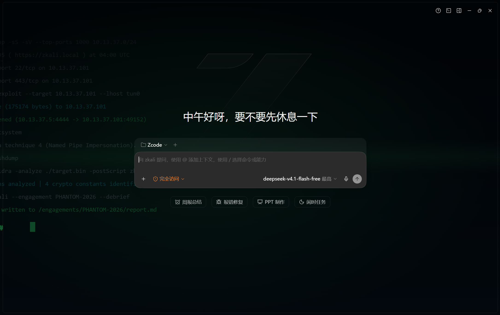
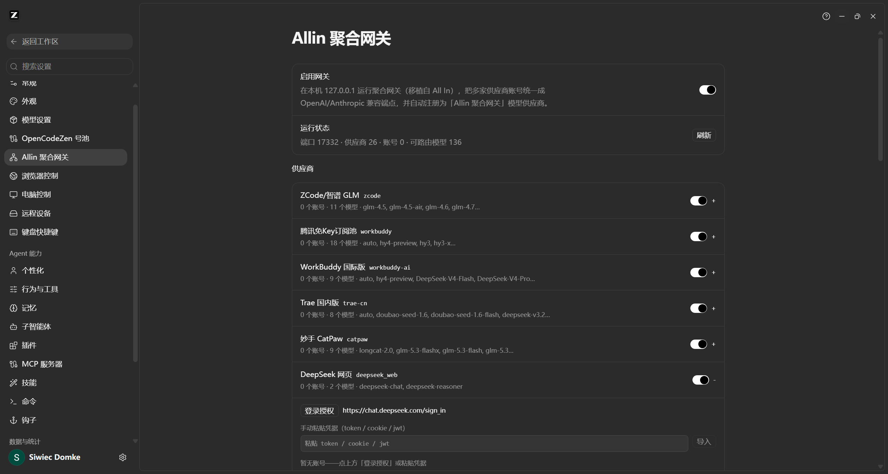
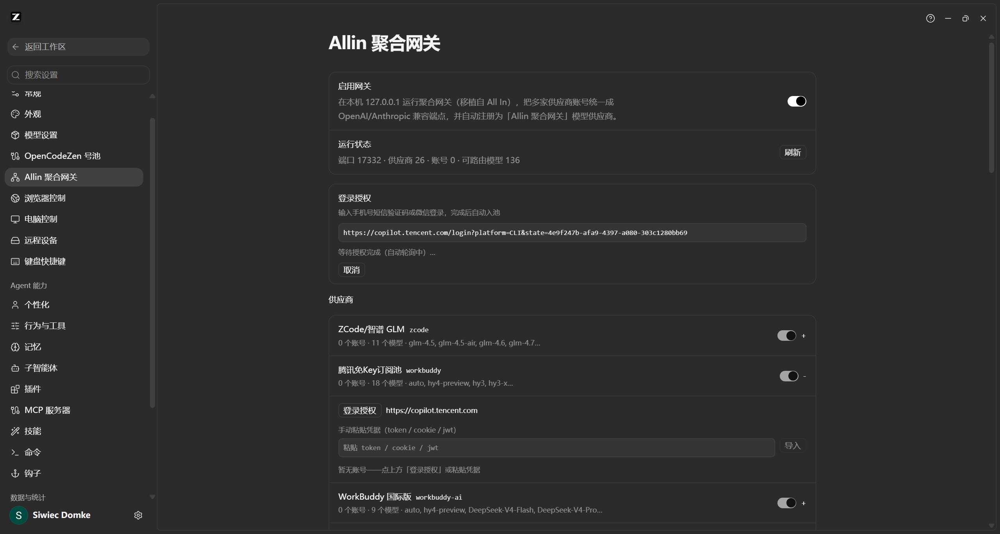
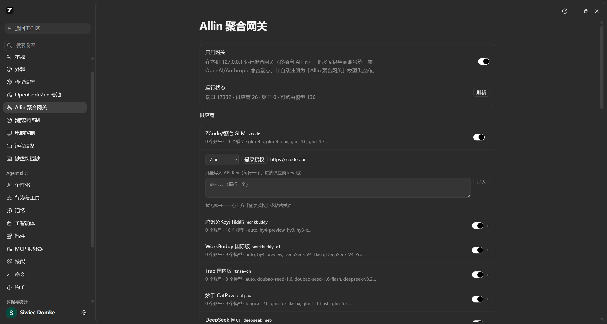
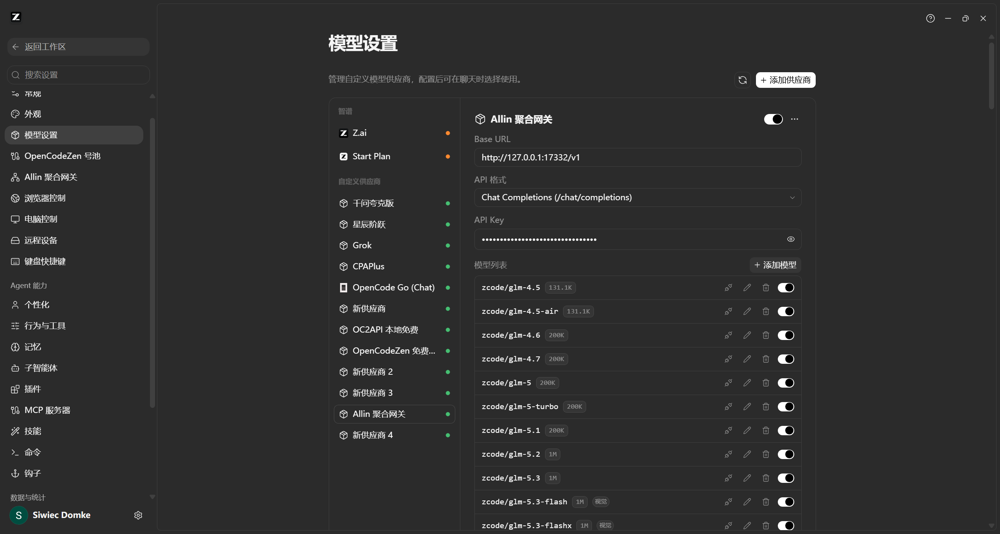
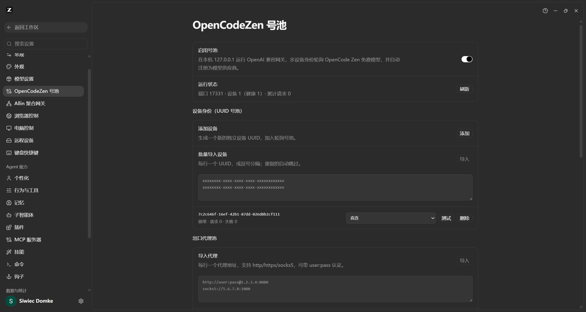

# zkali

**面向 AI 渗透、逆向、CTF 与授权红蓝队对抗的安全团队智能体发行版**——基于 [ZCode](https://github.com/zai-org/ZCode)（Apache-2.0）深度定制的开箱即用版本。

A security-focused AI agent distribution built on ZCode: penetration testing, reverse engineering, CTF solving, and authorized red/blue team operations — batteries included.



## 特性 / Features

### 内置安全团队（多智能体自动协同）
- **9 个专家子智能体**：`zkali-recon`（侦察）、`zkali-reverse`（逆向）、`zkali-pwn`（二进制利用）、`zkali-web`（Web 渗透）、`zkali-ctf`（CTF 解题）、`zkali-audit`（代码审计）、`zkali-red`（红队）、`zkali-blue`（蓝队防守）、`zkali-proxy`（代理轮换）
- **三层自动路由**：系统提示词常驻调度指令 + SessionStart hook 注入武器矩阵 + 子智能体 description 域路由——任务下发后主 agent 自动拆派，无需点名
- **10 个技能**（作战内核 + 8 域方法论 + 实验室规范）、**7 个斜杠命令**（`/recon /reverse /pwn /ctf /audit /redops /engagement`）
- **zkali-toolbox MCP**：武器探测（150+ 工具）、白名单受控执行、CTF 密码学台、作战日志——SEA/桌面打包态经 `__zcode-plugin-host` 自举，目标机无需 Node

### Allin 聚合网关（26 家供应商统一出口）

移植自 All In APK 的本地聚合网关，随应用自动驻留 `127.0.0.1:17332`：把多家供应商账号统一成 OpenAI/Anthropic 兼容端点，并自动注册为「Allin 聚合网关」模型供应商。



- **一键授权**：点「登录授权」→ 网关生成带设备识别码的授权 URL 并自动打开浏览器 → 登录完成后网关自动轮询回收账号入池，无需手动复制 cookie/token
- **三种授权形态**：设备轮询流（WorkBuddy / CatPaw / Copilot…）、本地回环回调（Trae / Raccoon / Codex…）、内置 WebView 登录窗（DeepSeek 网页版…）；手动粘贴凭据仅作兜底
- **26 家供应商 / 136 个模型**：`provider/model` 精确路由 + `auto`·`smart-coding`·`reasoning` 分组按序回退
- **账号池**：游标轮询 + 401/403/429/5xx 分档冷却回退；HTTP/SOCKS5 出口代理批量导入、连通性测试、一键分配
- **DeepSeek Web PoW**：完整移植 `DeepSeekHashV1` 工作量证明（SHA3-256 标准向量对拍通过）



ZCode 供应商支持 Z.ai / BigModel 双站点选择，亦可批量导入 API Key：



网关启用后自动注册为模型供应商（`http://127.0.0.1:17332/v1`），136 个 `provider/model` 模型带真实 contextWindow 全量可选：



### OpenCodeZen 免费号池

本机 `127.0.0.1:17331` 常驻 OpenAI 兼容网关：多设备身份（UUID）轮询 OpenCode Zen 免费模型，自动注册为模型供应商；支持设备批量导入、出口代理池与每设备代理绑定。



### Universal Kernel 预置
`universal-kernel-v31.md`（277 KB）逐字节内嵌于 `@zcode/shared`，双路注入：
- **个性化路**：`~/.zcode/AGENTS.md` 缺失/空白时兜底注入（用户文件非空时让位）
- **系统提示词路**：默认主 agent 在 identity 段后追加稳定 `Universal Kernel` 段（子智能体不受影响）

### 额度自动领取
登录态下营销投递命中 `claim_zcode_plan` 动作（晚间 20:00-23:00 的 GLM 免费额度弹窗/banner）即自动走原 verify→submit→权益刷新链路，未登录静默跳过。

### 壁纸主题模块
设置 → 外观 → 壁纸：6 张程序化生成原创 4K SVG 壁纸（蜂窝徽记 / 终端磷光 / 信号雨 / 电路板 / 等高山脊 / 霓虹地平线），画布玻璃透视 + 模糊/遮罩双滑杆，跨窗口同步。生成器见 `packages/ui/scripts/generate-wallpapers.mjs`。

### 品牌
产品身份全面更名 `zkali` / `zkali Preview`；**账号登录体系完整保留**（`zcode://` OAuth、`zcode.z.ai`、`~/.zcode`、`ZCODE_*` 环境变量、wire 协议串均未动）。

## 构建 / Build

```bash
pnpm bootstrap

# CLI 单文件 SEA（六目标）
pnpm --dir apps/zcode-cli --filter @zcode/cli sea --all

# 桌面版
pnpm --filter @zcode/desktop bundle -- --os win --arch x64
pnpm --filter @zcode/desktop bundle -- --os linux --arch x64
```

产物：`zkali-<os>-<arch>` SEA 单文件（win/linux/darwin × x64/arm64）、`zkali Preview-*-TEST.exe` NSIS 安装器、`zkali-preview` Linux 桌面（unpacked/tar.gz）。发布见 [Releases](https://github.com/HaizhuAI/Zkali/releases)。

## 文档 / Docs

- 发行版规格：`docs/zkali/2026-11-04-zkali-plugin-version-1-0-0-spec.md`
- 构建说明与产物清单：`D:\Devin\zkali\BUILD.md`（独立插件包形态）
- 上游 ZCode 原始 README：[README.upstream.md](README.upstream.md)；当前同步基线 **ZCode v4.0.0**（2026-11-23）

## 许可 / License

Apache-2.0（随上游）。zkali 新增代码与资产同许可分发；内置壁纸为本仓程序化生成的原创资产。
